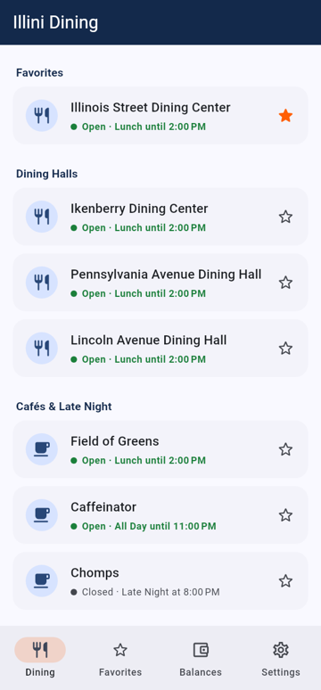
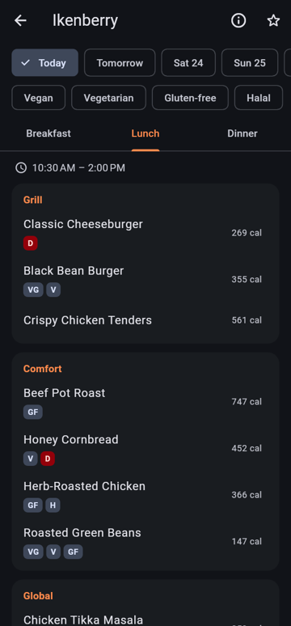
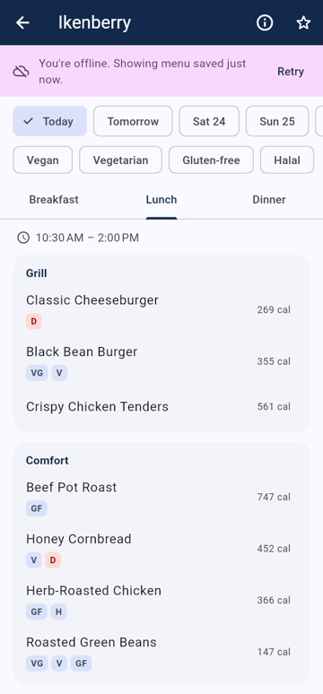
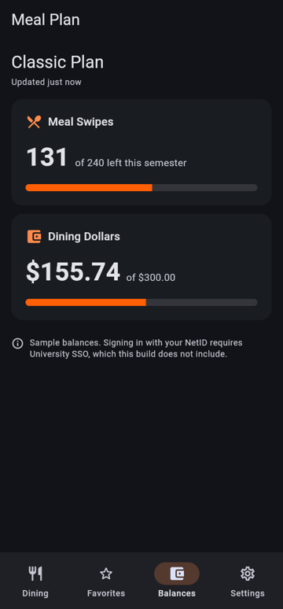

# Illini Dining

A Flutter app focused entirely on food at the University of Illinois Urbana-Champaign. It takes the
dining section of the Illinois app and gives it a dedicated home: see what every dining hall is
serving, pin your favorites, check your meal plan balances, and keep reading menus when the Wi-Fi
in the basement of your residence hall gives out.

> Not an official University of Illinois app. Menus and hours come live from University Housing's
> public feed; meal plan balances come from your own University Housing account after you sign
> in with your NetID (see [Data sources](#data-sources)).

| Dining list | Menu (dark) | Offline | Balances (dark) |
| --- | --- | --- | --- |
|  |  |  |  |

## Features

- **What's being served:** all 14 University Housing dining halls, cafés and markets, with live
  open/closed status ("Open until 3:00 PM · Lunch", "Closed · Dinner at 4:30 PM"). Each menu is
  split by meal (including Light Lunch, Kosher and Field of Greens), station and course. While a
  location is open, its card lists the stations serving right now. Menus open on the meal being
  served now, with stations collapsed so you can expand just what you want, and you can browse
  the next 7 days.
- **Dietary filters:** Vegan, Vegetarian, Halal, Kosher and Jain filters, kept between launches.
  Only diets that appear on the current menu are offered. Every item lists what it contains
  (gluten, milk, eggs, soy, nuts…).
- **Campus time:** hours and dates are always shown in Champaign time, whatever time zone the
  phone is set to.
- **Favorites:** star any location to pin it to the top of the list and to the Favorites tab.
  Favorites are stored on the device.
- **Offline menus:** every screen first shows what's saved on the device, then refreshes from the
  network.
  - Today's and tomorrow's menus for every location are downloaded automatically, favorites first.
  - Settings can download the whole week.
  - A quiet status line always says when the data on screen was updated, or that you're
    offline and when it was saved.
  - While offline, the app retries when the network connection changes, when it returns to the
    foreground, and on a timer that backs off from 15 seconds to 2 minutes. Once any request
    succeeds, every screen showing saved data refreshes itself.
  - Menus from past days are deleted automatically.
- **Meal plan balances:** remaining meals, Dining Dollars and Illini Cash from your University
  Housing account, summarized in a compact strip at the top of the Dining tab, with progress bars against your weekly allowance. Sign in once with your
  NetID; balances refresh in the background and stay viewable offline. When the University ends
  the session, the saved numbers stay up with a prompt to sign in again.
- **Light and dark mode:** Illini Orange and Illini Blue themes that follow the system setting.

## Getting started

```sh
flutter pub get
flutter run                                     # live University Housing data
flutter run --dart-define=USE_SAMPLE_DATA=true  # built-in sample data, works with no network
flutter test                                    # unit + widget tests (no network needed)
flutter analyze
dart run tool/live_feed_check.dart              # checks the live feed still parses
```

### App builds (CI)

`.github/workflows/build.yml` runs on every push. It analyzes and tests once, then builds both
apps in parallel and uploads them as workflow artifacts, kept for 30 days. Each download is the
app file itself, not a zip.

- **iOS:** an **unsigned** `.ipa`. Sign it yourself before installing, for example with
  Sideloadly, AltStore or `codesign`.
- **Android:** a release `.apk` for Android 11 or newer (older versions don't trust the
  University's certificate root). Allow installs from unknown sources to install it. To make
  each build install over the last one (keeping your sign-in and saved data), give CI a fixed
  signing key once:

  ```sh
  keytool -genkeypair -v -keystore release.jks -alias illini-dining \
    -keyalg RSA -keysize 4096 -validity 10000
  base64 -w0 release.jks   # macOS: base64 -i release.jks
  ```

  Then add repository secrets (Settings → Secrets and variables → Actions):
  `ANDROID_KEYSTORE_BASE64` (the base64 output), `ANDROID_KEYSTORE_PASSWORD`,
  `ANDROID_KEY_ALIAS` (`illini-dining`) and `ANDROID_KEY_PASSWORD`. Keep `release.jks` somewhere
  safe and out of the repo. Without these secrets, each build uses a different temporary key, so
  the previous version must be uninstalled first. For local release builds, the same values can
  go in `android/key.properties` (`storeFile`, `storePassword`, `keyAlias`, `keyPassword`), which
  is git-ignored.

To run it by hand, go to **Actions → Build apps → Run workflow**. Builds use the live feed by
default; the optional inputs override its URL or add a custom backend.

To try the offline experience, open a few menus, turn on airplane mode, and reopen the app. Saved
menus still load, with a banner saying when they were saved. Days that were never downloaded
explain why they aren't available. Sample-data builds also have **Settings → Simulate no
internet**.

## Architecture

```
lib/
  main.dart                  wires up storage + data source
  app.dart                   providers, MaterialApp (ThemeMode.system)
  config.dart                --dart-define settings
  models/                    DiningHall + hours/open status, DailyMenu, MealPlanBalance
  data/
    dining_api.dart          DiningApi / BalanceApi interfaces + HttpDiningApi
    demo_dining_api.dart     sample venues, generated menus and balances
    local_cache.dart         FileCache (JSON files on device) + MemoryCache (tests)
    dining_repository.dart   cache-then-network streams, prefetch, pruning
  state/                     ChangeNotifier controllers (provider)
  screens/                   dining list, hall menu, balances, settings
  widgets/                   shared UI and formatting
```

`DiningRepository` returns a `Stream<Loaded<T>>` for halls, menus and balances:

1. It first emits the saved copy, if there is one, so the screen renders instantly.
2. It fetches from the network and saves the result.
3. It emits the fresh value, or, if the fetch fails, the saved copy again with `error` set.

The UI treats that last case as "offline". Cache writes go to a temp file and are then renamed into
place, so a crash can't leave a half-written menu behind.

## Data sources

### University Housing menus (no sign-in)

The official Illinois app ([rokwire/illinois-app](https://github.com/rokwire/illinois-app)) loads
dining locations, hours and menus from a public University Housing feed. `IllinoisDiningApi` reads
that same feed at `https://web.housing.illinois.edu/MobileAppWS/api`:

| Endpoint | Response |
| --- | --- |
| `GET /LocationSchedules` | `{"DiningOptions": [{DiningOptionID, DiningOptionName, Type, Address, Lat, Long, MoreInfo, DiningSchedules: [{TimePeriod, StartTimeUTC, EndTimeUTC, …}]}]}`, with about two weeks of schedules |
| `GET /Menu/{DiningOptionID}/{M-d-yyyy}` | `[{ItemID, FormalName, Meal, ServingUnit, Course, CourseSort, Traits, …}]` |

The official app doesn't hard-code this URL; it receives it from its remote config. It was found
by following the public [Dining Menus](https://web.housing.illinois.edu/diningmenus) site, which
serves the same data. The responses were then checked against the official app's parsers
(`lib/model/Dining.dart`). `test/fixtures/` holds real responses captured on 2026-10-22, and
`tool/live_feed_check.dart` checks the live feed.

How the feed maps to the app:

- **Stations:** `ServingUnit` is the station (Gregory Drive Diner, Kosher Kitchen…). `Course`
  (Entrees, Starches…) becomes a subheading.
- **Hours:** schedule times are UTC seconds and are shown in campus time.
- **Traits:** the feed mixes diet types (Vegan, Vegetarian, Halal, Kosher, Jain) with
  ingredients an item contains (Gluten, Milk, Eggs, Peanuts…). Diet types become filters and
  badges; ingredients are listed in full under each item. The app never infers "gluten-free"
  from an ingredient being absent.
- **Nutrition:** the feed also has `/Nutrition/{ItemID}`, which the app doesn't use yet.

The app is light on the feed. It makes one request for the location list, plus one per menu: the
menus you open, and today's and tomorrow's menus fetched in batches of four. Requests carry a
`User-Agent` naming this project.

The server's certificate chains to *emSign Root CA - G1*, which current iOS and Android trust.
Some older Linux certificate stores lack it; `tool/live_feed_check.dart --ca-file=…` covers that
case for local checks.

To point the app at a different feed URL, use `--dart-define=ILLINOIS_DINING_URL=…`. For CI, set
the `ILLINOIS_DINING_URL` repository variable or the workflow input.

### Meal plan balances

Balances aren't in the public feed. The official app reads them from a Housing API using a token
from its own registered sign-in, which other apps can't use. Instead, this app reads the same
page students see in a browser:
[MyHousing → Meal Plan Balances](https://web.housing.illinois.edu/MyHousing/MealPlanBalances).

- **Sign-in:** *Sign in with NetID* opens that page in a WebView. The University redirects to its
  normal sign-in, now primarily Microsoft (`login.microsoftonline.com`, `login.microsoft.com`),
  with `shibboleth.illinois.edu` and Duo still involved for some sign-ins. The student signs in
  there; the password goes to the University, and the app never sees it. The top-level page can
  only be an `illinois.edu`, Microsoft sign-in or Duo address (frames inside those pages aren't
  restricted).
- **Passkeys:** passkey sign-in for Microsoft doesn't work inside the app. iOS and Android only
  allow passkeys in an app's embedded WebView for the app's *own* website, so a passkey for
  Microsoft has to be used in a real browser or a system sign-in sheet, which the app can't read
  from. Accounts with another sign-in method (Microsoft Authenticator, Duo) can use
  *Other ways to sign in*. See
  [passkeys.dev: iOS](https://passkeys.dev/docs/reference/ios/#webviews) and
  [Android](https://passkeys.dev/docs/reference/android/#webviews).
- **Reading:** once the Housing page loads, the app reads its visible text and parses the
  *Meal Plan*, *Meals Remaining*, *Dining Dollars* and *Illini Cash* tiles
  (`HousingBalanceApi.parseBalancesPage`). That's the only script the app runs, and only on that
  page. Plan names like `CLASSIC 10/45 D$` give the weekly allowance (10 meals, $45 Dining
  Dollars). Meals don't roll over; Dining Dollars roll over up to two weeks' worth, so that
  plan's bar measures against $90.
- **Staying signed in (Android):** Android's WebView already keeps session cookies across
  restarts; `MainActivity` flushes them to disk after sign-in and whenever the app is paused.
- **Staying signed in (iOS):** on iOS, a WebView keeps cookies that have an expiry date but drops
  session cookies (Microsoft's, Shibboleth's and Housing's sign-in sessions) whenever the app
  quits, unlike Safari. `SessionCookieKeeper` in `ios/Runner/AppDelegate.swift` saves the
  sign-in cookies for `illinois.edu`, Microsoft sign-in and Duo hosts to the Keychain (this device
  only, not backed up) whenever they change, and restores them once per launch before the first
  page loads. Each site still decides how long its session lasts. Answering **Yes** to
  Microsoft's "Stay signed in?" gives the longest-lived sign-in.
- **Refreshing:** later refreshes load the page in an off-screen WebView that shares the sign-in
  cookies. If the University asks for a sign-in again, the app keeps the saved numbers and offers
  *Sign in again*. Nothing is requested from the University until the student has signed in once,
  and *Sign out of University Housing* clears the cookies, the Keychain copy and the saved
  balances.

`test/fixtures/meal_plan_balances.html` is the balance section of the real page; if Housing
changes the page and balances stop appearing, update the fixture and the parser together.

### Custom backend

The app can also talk to a small JSON API you host, for example a proxy in front of University
services:

```sh
flutter run \
  --dart-define=DINING_API_BASE_URL=https://your-proxy.example.edu/api \
  --dart-define=DINING_API_TOKEN=...   # sent as a Bearer token to /balances
```

| Endpoint | Response |
| --- | --- |
| `GET /halls` | `[DiningHall]` |
| `GET /halls/{id}/menu?date=yyyy-MM-dd` | `DailyMenu` |
| `GET /balances` | `MealPlanBalance` |

The JSON shapes are the `toJson()` methods in `lib/models/`. For example, a menu item is
`{"name": "Chana Masala", "tags": ["vegan", "glutenFree"], "calories": 310}`. Hours are
`{"meal": "Lunch", "weekdays": [1,2,3,4,5], "opens": "10:30", "closes": "14:00"}`, with ISO
weekdays (Monday = 1). By default the University feed still supplies menus and the custom
backend supplies balances. To take menus from the backend too, also pass
`--dart-define=ILLINOIS_DINING_URL=` (empty).

### Sample data

`--dart-define=USE_SAMPLE_DATA=true` switches to built-in sample data, which works with no
network. Venue names and addresses reflect University Housing dining; hours, menus and balances
are illustrative only.
